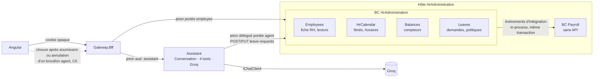
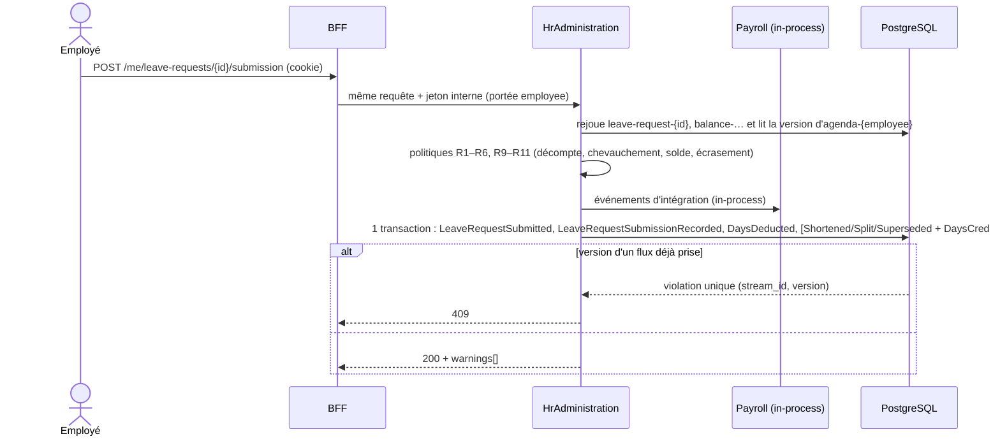
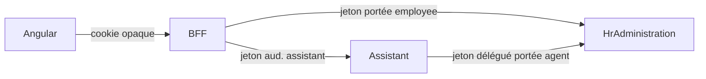
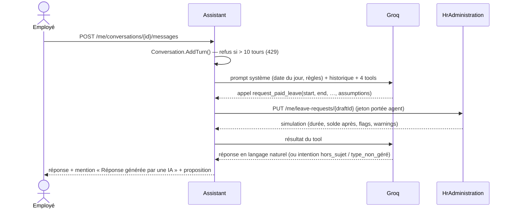

# Architecture Brief — Gestion des demandes de congé avec agent IA

> Ce document décrit l'architecture technique qui répond au [PRD v1.4](PRD.md).
>
> Version 1.0 du 01/11/2026. Chaque choix est relié à une décision du journal (section 13, références **AD**). Les règles du PRD sont citées par leurs références : **R** pour les règles métier, **A** pour les cas limites de l'agent, **C** pour la conformité, **D** pour les décisions du PRD.

## Sommaire
1. [Découpage](#1-découpage)
2. [Topologie et persistance](#2-topologie-et-persistance)
3. [Modèle et API](#3-modèle-et-api)
4. [Session et protection des données](#4-session-et-protection-des-données)
5. [Agent IA](#5-agent-ia)
6. [API et gestion des erreurs](#6-api-et-gestion-des-erreurs)
7. [Front-end Angular](#7-front-end-angular)
8. [Structure de la solution](#8-structure-de-la-solution)
9. [Stratégie de tests](#9-stratégie-de-tests)
10. [Traçabilité PRD → architecture](#10-traçabilité-prd--architecture)
11. [Écarts avec le PRD](#11-écarts-avec-le-prd)
12. [Pistes V2](#12-pistes-v2)
13. [Journal des décisions](#13-journal-des-décisions)

---

## Contexte

**Objectif unique : soumettre une demande de congé.**
- Il existe quatre types de congé : CP, RTT, Maladie et Sans solde.
- La demande se prépare de deux façons : dans un formulaire avec calendrier, ou avec un agent IA conversationnel.
- La fiche RH, les compteurs et le calendrier ne sont que des informations récupérées par API.
- **Rien n'est supprimé** : chaque action est tracée pour l'audit (C17).

**Contraintes**
- Back-end .NET / C# et front-end Angular (AD1).
- DDD en trois couches : Domain, Application, Infrastructure (AD2).
- Une API REST versionnée et documentée en OpenAPI par service (AD3).
- Aucun jeton ni identifiant utilisateur exposé au navigateur ou à l'agent (AD4).
- Tests d'architecture et tests fonctionnels exécutables **sans clé d'API** (AD5).

**Convention de nommage** : tout le code est en anglais, termes métier compris : identifiants, routes, événements, tools et codes d'erreur (AD22). Les documents restent en français. La section 3.0 fait la correspondance avec le langage ubiquitaire du PRD.

---

## 1. Découpage

| Service | Nature | Responsabilités | Exigences du PRD couvertes |
|---|---|---|---|
| **HrAdministration** (RH administratif) | Bounded context, cœur du domaine | Fiche RH, calendrier, compteurs, demandes et règles métier, audit | R1 à R11, C1, C3 à C5, C8, C15, C17 |
| **Assistant** | Microservice à part, qui porte l'agent IA (AD34) | Conversation, orchestration du LLM (Groq), 4 tools, garde-fous. C'est un **client** de l'API de HrAdministration : il n'accède ni à son domaine ni à sa base. | A1 à A9, C2, C4, C6, C7, C9 à C14 |
| **Payroll** (Paie) | Bounded context en squelette (AD8), **sans API**, hébergé dans le processus de HrAdministration (AD57) | Consomme en interne les événements d'intégration de demande et stocke des éléments variables de paie (Sans solde, Maladie). Aucune règle de calcul. | Préparation de la V2 |
| **Gateway.Bff** | Passerelle, ce n'est pas un BC | Session, traduction d'identité, routage (section 4) | C5, AD4 |

### Carte des services



Relations entre les contextes :
- **Assistant → HrAdministration** : *Customer/Supplier* en REST synchrone. L'Assistant ne référence que `HrAdministration.Contracts`.
- **HrAdministration → Payroll** : *Published Language*. Les événements d'intégration de demande (`HrAdministration.Contracts`) sont distribués **in-process**, dans la transaction de soumission (AD57). Il n'y a pas de bus de messages en V1 (AD56).
  - Il n'y a **aucun événement de contrat** (AD32).
  - Les événements ne contiennent **aucun texte libre**.

### Modules internes de HrAdministration
Les choix de l'utilisateur ont regroupé dans un seul BC les absences, les droits, le calendrier et l'administratif (AD15, AD17, AD18, AD31). Pour garder un modèle lisible, ce BC est découpé en **modules** : des namespaces du Domain et de l'Application, et non des BC séparés (AD28).

| Module | Rôle |
|---|---|
| `Employees` | Fiche RH : modèle de lecture seedé, sans agrégat (AD55) |
| `HrCalendar` | Calendriers fériés, horaires, qualification des jours. Ce module ne connaît **ni les types de congé ni les employés**. |
| `Balances` | Compteurs CP et RTT. Les JRTT du forfait jours sont un compteur `Rtt` limité à l'année en cours (AD63). |
| `Leaves` | Demandes de congé et politiques de règles |

Les modules communiquent in-process par la couche Application : **aucun module du Domain ne dépend d'un autre** (AD59). Quand un module a besoin d'un autre, il déclare un port, que la couche Application implémente. Des tests d'architecture vérifient leurs frontières.

### Shared Kernel minimal
Il contient seulement `AggregateRoot`, `Entity`, `IDomainEvent` et `Result`, sans aucun concept métier (AD10). Un test d'architecture contrôle sa taille.

---

## 2. Topologie et persistance

### 2.0 Composants
- **2 hôtes ASP.NET Core** et une **BFF** YARP (AD7, AD19) :
  - l'hôte **HrAdministration**, qui embarque aussi le BC **Payroll**, sans API (AD57) ;
  - l'hôte **Assistant**.
- **PostgreSQL**, une base par hôte (AD47, AD50). Payroll a son **propre schéma** (`payroll`) dans la base de son hôte.
- **Pas de RabbitMQ ni d'outbox en V1** (AD56, coupe K2) : la seule consommation d'événements, celle de Payroll, se fait in-process.
- **Sessions de la BFF en mémoire** (AD56, coupe K1) ; Redis est une piste V2.
- **.NET Aspire** pour l'orchestration locale : `dotnet run --project src/AppHost` (Docker requis).
- **.NET 10 LTS**.

### 2.1 Persistance

| Service | Contenu | Technique |
|---|---|---|
| **HrAdministration** | Demandes et compteurs en **event sourcing** (AD48), avec un **event store maison sur EF Core** (AD49). La fiche RH est stockée en état classique. | EF Core, migrations |
| **Assistant** | Table `conversations` (état, tours, codes) et table `messages` séparée, purgeable (C6) | EF Core |
| **Payroll** | Schéma `payroll` dans la base de l'hôte HrAdministration : table `payroll_variable_items`, avec une clé unique par événement (idempotence) | EF Core, `DbContext` propre au BC |

#### Event store de HrAdministration
**Table `events`**, en ajout seul. Ses colonnes :
- `stream_id`, `version`, `type` ;
- `data` et `metadata`, en JSONB ;
- `recorded_at`.

La contrainte **unique (stream_id, version)** assure la concurrence optimiste. Il n'y a jamais d'`UPDATE` ni de `DELETE` : l'event store **est** le journal d'audit (AD42, C17).

Les **métadonnées** de chaque événement contiennent :
- l'acteur : `employee` ou `agent`, selon la portée du jeton ;
- l'origine ;
- `correlation_id` ;
- `schema_version`.

| Flux | Événements | Rôle |
|---|---|---|
| `leave-request-{id}` | `LeaveRequestDrafted`, `LeaveRequestUpdated`, `LeaveRequestSubmitted`, `LeaveRequestCancelled`, `LeaveRequestShortened`, `LeaveRequestSplit`, `LeaveRequestSuperseded` | Cycle de vie d'une demande |
| `balance-{employee}-{type}-{year}` | `EntitlementGranted`, `DaysDeducted`, `DaysCredited` | Registre dont on déduit le compteur courant (AD30) |
| `agenda-{employee}` | `LeaveRequestSubmissionRecorded` (identifiant de la demande seulement) | Garde de concurrence de R4 et R10 : sérialise les soumissions d'un même employé (AD60) |

**Écriture.** Une soumission écrit dans **une seule transaction EF Core** :
- les événements de la demande ;
- l'événement du flux `agenda-{employee}`, avec la version lue **avant** le contrôle de R4 et R10 ;
- ceux du compteur ;
- ceux des demandes écrasées (R10) ;
- les éléments de paie, écrits par le BC Payroll à partir des événements d'intégration distribués in-process, dans la même transaction (AD57).

Aucune saga n'est nécessaire.

**Projections inline**, mises à jour dans la même transaction :

| Projection | Routes qu'elle alimente |
|---|---|
| `leave_requests_view` | `GET leave-requests`, `GET calendar/leaves`, `GET calendar/sick-leaves` |
| `balances_view` | `GET balances` |

- La répartition entre jours *pris* et *planifiés* est calculée à la lecture avec `IClock`.
- Les projections sont reconstructibles en rejouant les événements.
- Il n'y a **pas de snapshot** : un flux contient peu d'événements en V1.

**Données sensibles**
- Le commentaire n'apparaît que dans `LeaveRequestDrafted` et `LeaveRequestUpdated`, et jamais pour une Maladie (R6).
- Les événements ne sont jamais journalisés (C3).
- En V2, l'effacement RGPD passera par du *crypto-shredding*.

#### Schéma et données de démonstration (AD51)
- Migrations EF Core versionnées, appliquées au démarrage en développement.
- Seed idempotent, qui passe par **le même chemin que l'application**. Il crée :
  - la fiche RH des employés de démonstration (PRD, R8) ;
  - les événements `EntitlementGranted`, avec les valeurs de R8, pour 2026 et 2027, et `CurrentYearOnly` pour les JRTT du forfait jours ;
  - des demandes passées (`LeaveRequestDrafted` → `LeaveRequestSubmitted` → `DaysDeducted`), qui donnent des soldes déjà entamés.

### 2.2 Cohérence

| Flux | Mode | Garantie |
|---|---|---|
| Soumission (R1 à R11) | Local à HrAdministration, ajout dans plusieurs flux | Transaction unique, sans saga |
| Compteur courant | Projection du flux `balance-…` et date du jour | Toujours aligné sur les demandes soumises |
| Concurrence | Version attendue de chaque flux modifié (contrainte unique `stream_id, version`) | Deux écritures concurrentes sur la même demande ou le même compteur, ou deux soumissions d'un même employé (flux `agenda-{employee}`, AD60), ne peuvent pas aboutir toutes les deux (409) |
| Audit (C17) | L'event store | Aucun trou, aucune suppression |
| Tools de l'Assistant | REST synchrone vers HrAdministration | HrAdministration reste la seule source de vérité |
| Purge des conversations (C6) | Après la soumission ou l'annulation d'un brouillon d'origine `Agent`, le front appelle `closure` sur la conversation liée. Un job à 30 jours sert de filet. | Pas de bus nécessaire (AD56) |
| Vers Payroll | Événements d'intégration in-process, dans la transaction de soumission | Cohérence forte, idempotente |

### 2.3 Soumission d'une demande



---

## 3. Modèle et API

### 3.0 Correspondance entre le langage ubiquitaire (PRD) et le code

| PRD (FR) | Code (EN) |
|---|---|
| Fiche RH (identité, manager direct) | `EmployeeProfile` (modèle de lecture), `DirectManager` |
| Horaire, Lieu de travail | `WorkSchedule` (`FullTime5Days`, `PartTime80`), `WorkLocation` (département) |
| Calendrier férié ; jour ouvré, férié, de week-end, non travaillé | `PublicHolidayCalendar` (`General`, `AlsaceMoselle`) ; `DayKind` (`WorkingDay`, `PublicHoliday`, `Weekend`, `NonWorkingDay`), un dans `HrCalendar` et un dans `Leaves` (AD62) |
| Demande de congé, Période, Borne, Demi-journée | `LeaveRequest`, `LeavePeriod`, `PeriodBound`, `HalfDay` (`Morning`, `Afternoon`) |
| Type de congé : CP, RTT/JRTT, Maladie, Sans solde | `LeaveType` (abstrait) : `LeaveTypePaidLeave`, `LeaveTypeRtt`, `LeaveTypeSickLeave`, `LeaveTypeUnpaidLeave` |
| Statut : Brouillon, Soumise, Annulée, Remplacée | `LeaveRequestStatus` : `Draft`, `Submitted`, `Cancelled`, `Superseded` |
| Origine : saisie manuelle, agent | `Origin` : `Manual`, `Agent` |
| Durée décomptée | `CountedDuration` |
| Signalement : incertitude, incohérence | `Flag` : `Uncertainty`, `Inconsistency` |
| Déclaration tardive | `Warning.LateDeclaration` |
| Compteur : acquis, réservés (pris, planifiés), disponible | `LeaveBalance` : `Acquired`, `Reserved` (`Taken`, `Planned`), `Available` |
| Compteur de JRTT (forfait jours) | Compteur `Rtt` avec `CurrentYearOnly` (AD63) |
| Chevauchement, écrasement | `Overlap`, `SickLeaveOverride` |
| Conversation, tour | `Conversation`, `Turn` |

### 3.1 HrAdministration : modèle

#### Module `Employees`
- **Il n'y a pas d'agrégat employé** (AD55). La fiche n'est jamais modifiée en V1 et ne porte aucun invariant. C'est donc un **modèle de lecture** `EmployeeProfile`, alimenté uniquement par le seed (table `employee_profiles`). Il contient :
  - l'**identité, exposée par l'API** : `FirstName`, `LastName`, `JobTitle`, `DirectManager` (prénom, nom) ;
  - des **données internes, jamais exposées**, que lisent les politiques : `WorkSchedule` (R2) et `WorkLocation` (R11).
- **Pas de contrat de travail** (AD53, PRD D52) : ni modalité contractuelle, ni date d'entrée.
- L'identité n'est jamais journalisée (C3) ni transmise au LLM (C4).

#### Module `HrCalendar`
- `PublicHolidayCalendar` :
  - `General` : 11 jours ;
  - `AlsaceMoselle` : 13 jours, avec en plus le Vendredi saint (Pâques − 2) et le 26 décembre.
- `CalendarResolver` : les départements 57, 67 et 68 donnent `AlsaceMoselle` (R11, PRD D45).
- `WorkSchedule` : `FullTime5Days`, ou `PartTime80` (lundi, mardi, jeudi, vendredi).
- `DayQualifier` : donne le `DayKind` de chaque jour d'une période.

#### Module `Balances` (event sourcing)
- Agrégat `LeaveBalance`, reconstitué à partir du flux `balance-{employee}-{type}-{year}`.
  - **Types** : `PaidLeave` ou `Rtt` (AD63).
  - **Contenu** : `Acquired` et `CurrentYearOnly` (issus d'`EntitlementGranted`) et les mouvements `DaysDeducted` et `DaysCredited`, chacun rattaché à une demande.
  - **Compteur courant** : `Reserved` = `Taken` + `Planned` ; `Available` = `Acquired` − `Reserved`.
  - **Invariants** : R3 (solde suffisant, et période sur une seule année civile, celle du compteur, AD64) et R9 (un compteur `CurrentYearOnly`, celui des JRTT du forfait jours, ne vaut que pour l'année civile en cours). Une seule déduction par demande, ce qui rend l'opération idempotente.
- Les **droits acquis** sont seedés directement avec les valeurs de R8, sans contrat ni service de calcul (AD38, AD53).

#### Module `Leaves` (event sourcing)
- Agrégat `LeaveRequest`, reconstitué à partir du flux `leave-request-{id}`. Il contient :
  - `LeavePeriod` et `LeaveType` (`IsSensitive` pour `SickLeave`) ;
  - `Comment`, refusé pour `SickLeave` (R6) ;
  - `Status`, `Origin` et `CountedDuration` (avec le détail jour par jour) ;
  - `Flags[]` et `Warnings[]`.
- **Une politique par règle** (AD28). Ainsi, une décision du PRD (par exemple D39, D40 ou D45) peut évoluer sans toucher au reste :

| Politique | Règles |
|---|---|
| `CountingPolicy` | R2 : jours ouvrés, décompte légal des CP à temps partiel (PRD 4.1), jours travaillés pour la Maladie et le Sans solde (D39), demi-journée avant un jour non travaillé, qui ne s'étend pas à ce jour (D40) |
| `OverlapPolicy` | R4 |
| `SickLeaveOverridePolicy` | R10 : la demande est raccourcie, scindée ou remplacée, et les jours sont recrédités |
| `BackdatingPolicy` | R5 : antériorité permise pour la Maladie, avertissement au-delà de 48 h |

- **Aucune suppression** (AD42) : un brouillon est annulé ; une demande soumise est annulée selon R7.

**Ports** : `IEventStore`, `IEmployeeProfileReader`, `IClock`, `ICurrentEmployee`, `ILeaveCalendar` (donne à `Leaves` la nature de chaque jour, avec son propre `DayKind`, implémenté dans l'Application à partir de `HrCalendar`).

### 3.2 HrAdministration : API

Préfixe : `/api/v1/me/...`. L'employé courant est déduit du jeton et n'apparaît jamais dans la route (section 4).

| Domaine | Route | Rôle |
|---|---|---|
| **Fiche** | `GET hr-record` | Prénom, nom, poste et manager direct (prénom, nom) |
| **Compteurs** | `GET balances` | Compteurs CP et RTT courants : `acquired`, `reserved` (`taken`, `planned`), `available` |
| | `POST balances/simulations` | Simule une déduction de CP ou de RTT. Corps : `{ type, start, startHalfDay, end, endHalfDay }`. Renvoie les jours décomptés, le solde après déduction et si elle est possible (R3, R9). |
| **Calendrier** | `GET calendar/working-days?start=&end=` | Nombre de jours ouvrés, une fois retirés les jours fériés du calendrier de l'employé (R2, R11). Demi-journées en option. |
| | `GET calendar/leaves?start=&end=` | Indique si un CP, un RTT ou un Sans solde est déjà posé sur la période, et lequel (R4) |
| | `GET calendar/sick-leaves?start=&end=` | Indique si un arrêt maladie est déjà posé sur la période. Ne renvoie que les périodes (C15). |
| **Demandes** | `POST leave-requests` | Simule la demande et crée un brouillon. La réponse contient la durée, le solde après, les flags, les écrasements (R10) et les warnings (R5). |
| | `PUT leave-requests/{id}` | Met à jour un brouillon et le simule de nouveau. L'agent appelle cette route à chaque tour. |
| | `GET leave-requests` | Liste les demandes, quel que soit leur statut |
| | `POST leave-requests/{id}/submission` | Contrôle R1 à R6 et R9 à R11, applique R10, puis passe la demande au statut `Submitted`. La déduction du solde se fait **en interne** dans la même transaction (événement `DaysDeducted` sur le flux du compteur). Aucune route n'expose la déduction (AD45). |
| | `POST leave-requests/{id}/cancellation` | Annule un brouillon, ou une demande soumise dont le congé n'a pas commencé (R7). Recrédite le solde. |

**Aucune route `DELETE`** (AD42, C17).

**Événements d'intégration** : `LeaveRequestSubmitted`, `LeaveRequestCancelled`, `LeaveRequestShortened`, `LeaveRequestSplit`, `LeaveRequestSuperseded`.
- Contenu : l'employé (GUID opaque), le type, la période et la durée.
- Jamais de commentaire ni d'identité.

### 3.3 Assistant (microservice de l'agent)

| Couche | Contenu |
|---|---|
| **Domain** | Agrégat `Conversation` : identifiant du brouillon lié (gardé côté serveur, jamais transmis au LLM), 10 tours au plus, statut, expiration à 30 jours, sorties sous forme de codes, contenu purgeable (C6, C13, C14) |
| **Application** | Orchestration, 4 tools, garde-fous. Le port `IHrAdministrationClient` n'expose **que** `POST leave-requests` et `PUT leave-requests/{id}`. Il ne permet ni lecture, ni soumission, ni annulation, ni déduction (C11). |
| **Infrastructure** | Adaptateur Groq (`IChatClient`), client HTTP typé, EF Core, job de purge à 30 jours |
| **API** | `POST /api/v1/me/conversations` (la réponse porte la mention IA, C9) · `POST .../{id}/messages` · `GET .../{id}` · `POST .../{id}/closure` (clôt la conversation et purge son contenu ; pas de `DELETE`, C8) |

### 3.4 Payroll (BC squelette, sans API)
- **BC distinct** (projets `Payroll.Domain`, `Payroll.Application` et `Payroll.Infrastructure`), mais **sans API ni hôte propre**. Il est chargé par l'hôte HrAdministration (AD57).
- Il consomme **in-process** les événements d'intégration de `HrAdministration.Contracts` (`LeaveRequestSubmitted`, `LeaveRequestCancelled`, `LeaveRequestShortened`, `LeaveRequestSplit`, `LeaveRequestSuperseded`). Ces événements sont distribués dans la transaction de soumission. Seuls `UnpaidLeave` et `SickLeave` sont retenus.
- Il contient l'agrégat `PayrollVariableItem`, persisté dans le schéma `payroll` avec un `DbContext` propre. La clé unique par événement garantit l'idempotence.
- Il ne référence que `HrAdministration.Contracts`, jamais le Domain ni l'Application de HrAdministration.

---

## 4. Session et protection des données

### La BFF (Backend For Frontend)
La BFF est un petit service ASP.NET Core dédié au front Angular. **Ce n'est pas un bounded context** : elle ne contient aucune règle métier. C'est le **seul point d'entrée public**. Elle a trois rôles :

1. **Gardienne de la session.** Elle crée la session, la garde en mémoire en V1 (Redis en V2, AD56) et pose un cookie opaque. Elle seule sait quel employé se cache derrière ce cookie.
2. **Traductrice d'identité.** À chaque requête, elle remplace le cookie par un jeton interne de courte durée. Le navigateur ne voit jamais ce jeton.
3. **Routeur** (reverse proxy YARP).
   - `/me/conversations` part vers l'Assistant ; le reste de `/me` part vers HrAdministration.
   - La BFF sert aussi Angular (même origine, donc pas de CORS) et regroupe les documents OpenAPI.



### Règles
1. **Démonstration** : `POST /api/v1/session` avec l'employé de démonstration choisi (PRD, R8). Le cookie est `HttpOnly`, `Secure` et `SameSite=Strict`, avec une protection anti-CSRF.
2. Le navigateur ne voit **jamais** de jeton ni d'identifiant d'employé. Toutes les routes métier sont en `/me/...`.
3. Le jeton interne est un JWT signé, de courte durée, avec une audience par service. Il ne circule que sur le réseau interne.
4. **Portée `agent` et moindre privilège** (AD37) : l'Assistant échange le jeton de l'utilisateur contre un jeton délégué de portée `agent`. Ce jeton n'autorise **que** les deux opérations dont l'agent a besoin, sur la base d'une **liste blanche** :
   - `POST leave-requests`, qui crée un brouillon d'origine `Agent` ;
   - `PUT leave-requests/{id}`, uniquement sur un brouillon d'origine `Agent`.

   Toute autre route renvoie **403** (`scope.agent_forbidden`) : lecture de la fiche, des compteurs, des demandes ou du calendrier, soumission, annulation, modification d'un brouillon manuel ou d'une demande soumise. C'est une défense en profondeur, en plus du client de l'Assistant qui n'expose que ces deux opérations (C11). L'acteur `agent` est inscrit dans les métadonnées des événements.
5. L'employé courant est lu via `ICurrentEmployee`. Une ressource appartenant à un autre employé renvoie **404** (C5).
6. **Le LLM ne voit** ni identifiant, ni jeton, ni identité de l'employé (C4).
7. **Journaux** (C3, C15) :
   - liste blanche de champs ;
   - un enrichisseur remplace `SickLeave` par la catégorie `sensitive` ;
   - ni texte libre ni identité ;
   - télémétrie OpenTelemetry via Aspire.

---

## 5. Agent IA

### 5.1 Fournisseur
- **Groq**, compatible OpenAI, via `IChatClient` (Microsoft.Extensions.AI) (AD9).
- Le modèle se choisit par configuration. La clé est lue dans les user-secrets ou une variable d'environnement, jamais dans le dépôt.
- **V2** : fournisseur hébergé en France. Seul l'adaptateur change.
- **À vérifier pour C7** : la politique de rétention et d'entraînement de Groq.

### 5.2 Tools : un par type de congé (AD33)

| Tool | Paramètres | Routes appelées | Règles |
|---|---|---|---|
| `request_paid_leave` | `start`, `start_half_day`, `end`, `end_half_day`, `comment?`, `assumptions[]` | `POST leave-requests` au premier tour, puis `PUT leave-requests/{id}` | R1 à R6, R11 (y compris le temps partiel, A8) |
| `request_rtt` | idem | idem | R3 sur le solde RTT, plus **R9** si le compteur est `CurrentYearOnly` |
| `request_unpaid_leave` | idem | idem | Pas de R3 ; seuls les jours travaillés comptent (D39) |
| `declare_sick_leave` | bornes, demi-journées, `assumptions[]`. **Pas de `comment`** (C1, C2, C15) | idem | R5 ; aperçu de R10 (A7) |

**Pas de tool de lecture** (AD21). L'agent ne connaît que deux choses (C4, PRD D55) :
- la **date du jour**, injectée dans le prompt système par `IClock` ;
- la **réponse de simulation** que renvoie chaque tool : décompte, solde après, chevauchements, écrasements et warnings.

Règles communes à tous les tools :
- Une conversation n'a qu'**un seul brouillon** : changer de tool change le type de ce brouillon (A2).
- Les `assumptions[]` sont des codes (`YEAR_INFERRED`, `TYPE_INFERRED`, …). Ils deviennent des `Flag.Uncertainty`. Les `Flag.Inconsistency` viennent du domaine (A3, A5).
- **Aucun tool ne soumet ni n'annule** (C11).

### 5.3 Un tour de conversation



### 5.4 Garde-fous déterministes (hors du LLM)
- **10 tours au plus**, appliqué par `Conversation` (C14).
- **Hors-sujet ou jailbreak** : message fixe de refus (A1).
- **Type non géré en V1** (mariage, maternité…) : le back-end renvoie ce message fixe, sans toucher au brouillon (A9, AD39) :
  > « Je ne peux préparer que des congés payés, des RTT, des arrêts maladie ou des congés sans solde. Désolé, ce type de congé n'est pas encore géré par l'application. »
- **Mention IA** : ajoutée par le back-end, pas par le LLM (C9).
- **Questions médicales** : le prompt système les interdit. Le tool Maladie n'a pas de paramètre de commentaire (A6, C2).
- **Journaux** : aucun contenu de conversation n'y figure.

---

## 6. API et gestion des erreurs
- **Versionnement** dans l'URL (`/api/v1`), avec `Asp.Versioning.Http`.
- **Documentation** : OpenAPI natif (`Microsoft.AspNetCore.OpenApi`), un document par service, regroupés dans la BFF et affichés avec Scalar.
- **Format d'erreur** : *ProblemDetails* (RFC 9457), avec un `code` stable, un message en français et des `errors` par champ.

| Code | Règle |
|---|---|
| `period.invalid` | R1 |
| `duration.zero` | R2 |
| `balance.insufficient` | R3 |
| `period.spans_two_years` | R3 : CP ou RTT à cheval sur deux années civiles |
| `period.outside_counter_year` | R3 : période d'une autre année que celle du compteur |
| `period.overlap` | R4 |
| `backdating.forbidden` | R5 |
| `comment.too_long` | R6 |
| `comment.forbidden_for_sick_leave` | R6 |
| `cancellation.leave_started` | R7 |
| `jrtt.outside_year` | R9 |
| `request.invalid_status` | Statut incompatible avec l'opération (par exemple, `PUT` sur une demande soumise) |
| `scope.agent_forbidden` | C11 |

- **Avertissement** `declaration.late` (R5) : il est renvoyé dans `warnings[]` d'une réponse 200 ou 201. Ce n'est jamais une erreur (AD29).

| Statut | Cas |
|---|---|
| 400 | Requête mal formée |
| 403 | Portée `agent` sur une route interdite |
| 404 | Ressource absente, ou appartenant à un autre employé |
| 409 | Conflit de concurrence |
| 422 | Règle métier violée, ou statut incompatible |
| 429 | Limite de tours atteinte |
| 503 | LLM ou service en aval indisponible |

---

## 7. Front-end Angular
- Composants standalone et signals. Angular ne parle **qu'à la BFF**.
- **Un seul écran en V1** (AD56, coupe K4) qui regroupe les blocs ci-dessous.
- **Démarrage** : choix de l'employé de démonstration.
- **En-tête** : identité de l'employé (`GET hr-record`).
- **Compteurs** : acquis, réservés (dont pris et planifiés) et disponible (`GET balances`).
- **Mes demandes** (`GET leave-requests`) : actions *reprendre un brouillon* et *annuler*.
- **Formulaire avec calendrier** :
  - données du calendrier : `GET calendar/working-days`, `calendar/leaves` et `calendar/sick-leaves`. Les jours fériés et les jours non travaillés sont signalés (R2, R11).
  - pas de champ commentaire pour la Maladie ;
  - simulation déclenchée par un bouton « Simuler » (`POST` puis `PUT leave-requests`) ;
  - confirmation avant un écrasement (R10).
- **Panneau de l'agent** :
  - badges « Réponse générée par une IA » et « Proposé par l'IA, à vérifier » (C9, C10) ;
  - champs remplis par hypothèse mis en évidence ;
  - après la soumission ou l'annulation d'un brouillon d'origine `Agent`, appel de `closure` sur la conversation liée (purge C6).

---

## 8. Structure de la solution
```
src/
  AppHost/  ServiceDefaults/  Gateway.Bff/
  BuildingBlocks/SharedKernel/
  Services/
    HrAdministration/HrAdministration.{Domain,Application,Infrastructure,Api,Contracts}/
       Domain/{Employees,HrCalendar,Balances,Leaves}/
    Assistant/Assistant.{Domain,Application,Infrastructure,Api}/
    Payroll/Payroll.{Domain,Application,Infrastructure}/   # BC sans API, chargé par l'hôte HrAdministration
web/                                   # Angular
tests/
  Architecture.Tests/
  HrAdministration.Domain.Tests/  HrAdministration.Application.Tests/
  HrAdministration.Api.Tests/  HrAdministration.Infrastructure.Tests/
  Assistant.Domain.Tests/  Assistant.Application.Tests/
  Payroll.Application.Tests/
docs/  PRD.md  ARCHITECTURE.md
```

---

## 9. Stratégie de tests

Tous les tests unitaires s'exécutent **sans clé d'API ni réseau**. Les tests d'infrastructure sont isolés dans leur propre projet, car ils demandent Docker.

| Niveau | Contenu |
|---|---|
| **Architecture** (ArchUnitNET ou NetArchTest) | Domain ne dépend que du SharedKernel : ni EF Core, ni ASP.NET, ni Microsoft.Extensions.AI. Application ne dépend pas d'Infrastructure. `HrCalendar` ne référence ni `Leaves` ni `Balances`. Aucun module du Domain de HrAdministration ne référence un autre module. Assistant ne référence que `HrAdministration.Contracts`. Payroll ne référence que `HrAdministration.Contracts` et n'expose aucune route. Le SharedKernel reste minimal. Les événements de domaine ne dépendent pas de la sérialisation. Aucun contrôleur n'expose de `DELETE` sur les demandes. |
| **Domaine HrAdministration** (xUnit, sans base) | Une suite par règle, de R1 à R11. Le tableau 4.1 du PRD (temps partiel) est rejoué. Les agrégats event-sourcés sont testés en *given / when / then* : événements passés → commande → événements produits ou erreur. Cas limites : R3 (CP ou RTT à cheval sur deux années), R5 (plus de 48 h), R9 (deux années), R10 (scission). `HrCalendar` : jours fériés 2026 et 2027, Vendredi saint, 26 décembre, départements 57, 67 et 68, temps partiel. `LeaveBalance` : jours pris et planifiés selon la date du jour, recrédit, idempotence. Annulation d'un brouillon et d'une demande soumise. Conformité du seed à R8. |
| **Event store** (store en mémoire, sans Docker) | Conflit de version (409). Deux soumissions simultanées d'un même employé : une seule aboutit, l'autre reçoit un 409. Égalité entre projections reconstruites et projections inline. Seed idempotent. Les tests Testcontainers PostgreSQL sont une piste V2 (AD56, coupe K3). |
| **API HrAdministration** (`WebApplicationFactory`) | Les 11 routes. Format ProblemDetails. Warnings renvoyés en 200 ou 201. 404 sur la ressource d'un autre employé. Liste blanche de la portée `agent` : `POST` et `PUT` d'un brouillon d'origine `Agent` autorisés, toute autre route en 403. La soumission déduit le solde une seule fois, même si elle est rejouée. `hr-record` ne renvoie que l'identité. |
| **Assistant** | `IChatClient` simulé et scripté, `IHrAdministrationClient` simulé. Workflow des 4 tools : `POST` au premier tour, puis `PUT`. Aucun identifiant ni aucune identité envoyés au LLM. Le client ne propose que `POST` et `PUT`. 11ᵉ tour refusé. Messages fixes A1 et A9. Purge par `closure` et à 30 jours. Aucun contenu dans les journaux (vérifié avec un logger de test). |
| **Payroll** | Seuls `UnpaidLeave` et `SickLeave` sont retenus. Idempotence : un même événement rejoué ne crée pas de doublon. |

---

## 10. Traçabilité PRD → architecture

| PRD | Composant et route |
|---|---|
| R1, R6 | `LeavePeriod`, `Comment` · `POST` et `PUT leave-requests` |
| R2, R11 | `CountingPolicy`, `HrCalendar` · `GET calendar/working-days` |
| R3, R9 | `LeaveBalance` · `GET balances`, `POST balances/simulations`, déduction interne à la soumission |
| R4, R10 | `OverlapPolicy`, `SickLeaveOverridePolicy`, flux `agenda-{employee}` · `GET calendar/leaves`, `GET calendar/sick-leaves` |
| R5 | `BackdatingPolicy`, `Warning.LateDeclaration` |
| R7 | `POST leave-requests/{id}/cancellation`, `DaysCredited` |
| R8 | Seed : `EntitlementGranted` et demandes passées |
| A1 à A9 | Tools et garde-fous de l'Assistant |
| C1 à C3, C15 | Schéma du tool Maladie, enrichisseur de journaux, événements jamais journalisés |
| C4 | Pas de tool de lecture ; ni identité ni identifiant envoyés au LLM |
| C5 | `ICurrentEmployee`, 404 |
| C6, C8, C13, C14 | `Conversation`, purge, route `closure` |
| C7 | Configuration Groq (à vérifier) |
| C9 à C12 | Mention IA côté back-end, `Origin`, portée `agent`, IA tenue hors de l'approbation |
| C17 | Event store en ajout seul, métadonnées d'acteur, aucune route `DELETE` |

---

## 11. Écarts avec le PRD
Les écarts relevés pendant la conception ont été intégrés au PRD v1.4 (D52 à D58). **Aucun écart ne reste ouvert.** Le message de A9 (type non géré) est validé (D58, AD39).

---

## 12. Pistes V2
- Congés familiaux et de parentalité (PRD §9).
- Contrat de travail et calcul des droits.
- Workflow d'approbation : rôle du manager direct, équipe, délégation.
- Notifications.
- Consultation de l'audit par les RH.
- Quotas d'usage de l'agent dans la BFF.
- LLM hébergé en France.
- OIDC dans la BFF.
- Règles de paie.
- Crypto-shredding pour l'effacement RGPD.
- RabbitMQ et outbox, si Payroll ou l'Assistant passent dans des services séparés ; purge des conversations par événement.
- Sessions de la BFF dans Redis.
- Tests d'infrastructure Testcontainers.
- Front enrichi : plusieurs écrans, simulation en direct.
- Jours chômés d'usage.
- Extraction de modules de HrAdministration si la charge le justifie.

---

## 13. Journal des décisions
Les décisions viennent de la session de conception du 01/11/2026. Chaque décision cite la demande d'origine telle quelle. Les propositions de l'assistant IA sont indiquées comme telles.

**Encore à valider** : aucune.

| # | Décision | Source |
|---|---|---|
| AD1 | Back-end .NET/C#, front-end Angular | « comme le test technique le précise il faut développer en .NET / C# pour le back-end, Angular pour le front-end » |
| AD2 | DDD en couches Domain, Application, Infrastructure | « il faut suivre les règles d'architecture DDD avec Domain, Application, Infracstructure » |
| AD3 | Une API REST par BC, documentée en OpenAPI | « Pour chaque bounded countext, une api sera en face. Chaque API sera Restful et documentés via OpenAPI. » |
| AD4 | Aucun jeton ni identifiant utilisateur exposé ; gestion de session | « ne pas exposer des données sensibles comme des jetons ni id utilisateur aux api ni à l'agent. Une gestion de session devra surement être nécessaire. » |
| AD5 | Tests d'architecture et tests fonctionnels | « Des tests unitaires devront etre implémentés pour vérifier les règles DDD (pas de dépendances de l'infrastructures dans les fichiers du domaine et avoir des bounded context clean) et des tests unitaires sur les fonctionnalités. » |
| AD6 | Quatre tools métier. *Confirmée par AD33* | « il faudra exposer plusieurs tools : prendre un congés payés, prendre un congé sans solde, prendre un RTT, déclarer une absence d'arret maladie. Chaque tool aura un workflow spécifique comme décrit dans le PRD. » |
| AD7 | Microservices | Choix « Microservices », contre le monolithe modulaire recommandé par l'IA |
| AD8 | Paie en squelette dès la V1. *Hébergement modifié par AD57* | Choix « Squelette minimal en V1 », contre la recommandation de l'IA |
| AD9 | Groq en V1, hébergement en France en V2 | « utilise Groq dans un 1er temps (on pourra ensuite penser à une deuxieme version avec une solution avec hébergement en France) » |
| AD10 | Shared Kernel le plus petit possible | « le Shared Kernel doit etre le plus petit possible. » |
| AD11 | Première correction des BC | « la définition des Bounded Context que je t'ai donné ne sont pas correctes : Absence (pour les demandes d'absences, validation et solde), Droits à congés (Collaborateur, Manager, Equipe et Delegation) et Calendrier (Jours fériés, Jours ouvrés, Horaires) et Paie. Le chatbot est dans Absences. » |
| AD12 | Droits calculés hors du solde. *Caduque* | Choix « Droits à congés » |
| AD13 | Contrat et modalité dans RH administratif. *Contrat retiré par AD53* | « Il va dans contexte RH administatif / Contrat » |
| AD14 | Manager, Équipe et Délégation seulement documentés | Choix « Documentés seulement » |
| AD15 | Droits à congés fusionné dans RH administratif | « tout ca c'est dans RH administratif la couche (droit à congé n'a pas de sens) » |
| AD16 | Définition de la BFF | Question « qui est BFF ? » |
| AD17 | Absences dans RH administratif, sauf contradiction | « Absence doit vivre danss RH administratif. Il n'y a pas raison qu'il soit un BC différent sauf contradiction. » |
| AD18 | Fusion complète dans RH administratif. *Déploiement de l'agent modifié par AD34* | « Fusionner tout dans RH administratif : l'agent lui est un Building Block différent mais il fait partie du meme BC RH administratif » |
| AD19 | Session : BFF, cookie opaque, jeton interne, routes `/me` | Proposition de l'IA, **validée** (« validé ») |
| AD20 | Aspire, RabbitMQ avec MassTransit 8 et outbox, PostgreSQL avec une base par service. *RabbitMQ, outbox et Redis reportés en V2 par AD56* | Proposition de l'IA, **validée** (« validé ») |
| AD21 | Tool de lecture `consulter_ma_situation` | Proposition de l'IA, **refusée** (« refusé »). Annule AD36 |
| AD22 | Code entièrement en anglais, termes métier compris (correspondance en 3.0) | « terme métier en anglais, termes techniques en anglais » |
| AD23 | Réalignement sur le PRD v1.2. *Remplacée par AD40* | « relis le PRD et mets à jour le Architecture Brief — Gestion des demandes de congé avec agent IA (brouillon) » |
| AD24 | `Employee` et `HrRecord`. *Remplacée par AD55* | Proposition de l'IA, **refusée** (« refusé ») |
| AD25 | Calendrier comme BC. *Remplacée par AD31* | Proposition de l'IA |
| AD26 | Droit événementiel. *Caduque (PRD D51)* | Proposition de l'IA |
| AD27 | 11 tools. *Rejetée* | Proposition de l'IA |
| AD28 | Modules internes et une politique par règle | Proposition de l'IA, **validée** (« oui ») |
| AD29 | Avertissements renvoyés en 200 ou 201 ; enrichisseur de journaux | Proposition de l'IA, **validée** (« oui ») |
| AD30 | Compteurs courants persistés, calculés à partir de ce qui a été pris | « il faut aussi calculer les compteurs courant en fonction de ce qui a été deja pris (besoin de persistance) » |
| AD31 | Calendrier RH en sous-module | « basculer dans RH administratif : calendrier RH en tant que sous modules » |
| AD32 | Aucun événement de contrat | « n'implémente pas ces évèvenements » |
| AD33 | Un tool par type : CP, RTT, Maladie, Sans solde | « faire un tool uniquement pour chacun des Types de congé : congés payés, RTT, maladie, sans solde. » |
| AD34 | Agent dans un microservice à part | « le serveur de l'agent doit etre un microservice à part » |
| AD35 | PRD non modifié par le brief. *Écarts finalement intégrés au PRD v1.4* | Choix « Ne pas toucher au PRD » ; puis « corrige le PRD avec les ecarts » |
| AD36 | 5ᵉ tool en lecture. *Annulée par le refus d'AD21* | Choix « 5ᵉ tool en lecture » |
| AD37 | **Moindre privilège pour l'agent** : la portée `agent` n'autorise, par liste blanche, que `POST leave-requests` et `PUT leave-requests/{id}` sur un brouillon d'origine `Agent`. Toute autre route renvoie 403. | Proposition de l'IA, **validée et durcie** : « l'objectif etant de donner le moins d'éviter à l'agent d'agir principe du least priviledge » |
| AD38 | Compteurs de l'année initialisés sans événement de contrat | Proposition de l'IA, **validée** (« validé le contrat n'est pas nécessaire on a juste besoin de ses compteurs ») |
| AD39 | Message fixe pour un type non géré (PRD A9) : « Je ne peux préparer que des congés payés, des RTT, des arrêts maladie ou des congés sans solde. Désolé, ce type de congé n'est pas encore géré par l'application. » | Proposition de l'IA, **validée** : « oui, tu peux renvoyer : Je ne peux préparer que des congés payés, des RTT, des arrêts maladie ou des congés sans solde. Désolé, ce type de congé n'est pas encore géré par l'application. » |
| AD40 | Réalignement sur le PRD v1.3 | « réaligne l'architecture brief avec le PRD v1.3 » |
| AD41 | API réduite à l'essentiel | « Rappelle toi que l'objectif est juste de soumettre une demande de congé : le reste sont des informations qu'on doit récupérer par api » ; « GET situation-agent : Pas besoin de cette route Contexte agent » |
| AD42 | Aucune suppression : pas de `DELETE`, l'annulation la remplace ; audit | « supprime cela c'est le post annulation » on peut pas delete une requete vu que tout doit etre tracer (outil d'audit » |
| AD43 | Routes `GET leave-requests`, `PUT leave-requests/{id}` et `POST .../cancellation` | Choix « GET liste des demandes, PUT brouillon, POST annulation » |
| AD44 | Fiche exposée réduite à l'identité | « on a juste besoin de fiche rh employé (nom, prénom, poste, manager direct) » ; choix « Identité seulement » |
| AD45 | **Pas de route de déduction** : la déduction du solde se fait en interne, dans la transaction de soumission (`DaysDeducted`, une seule fois par demande). La route `POST balances/deductions` est supprimée. | « plus besoin de cette route et le faire en interne » |
| AD46 | Profils de démo non détaillés ici (voir PRD, R8) | « pas besoin » ; choix « Juste ne pas détailler » |
| AD47 | PostgreSQL | Choix « PostgreSQL », qui était la recommandation de l'IA |
| AD48 | Event sourcing des demandes et des compteurs ; l'event store fait office d'audit | Choix « Event sourcing », contre l'approche « état + journaux » recommandée par l'IA |
| AD49 | Event store maison sur EF Core | Choix « Event store maison EF Core », qui était la recommandation de l'IA |
| AD50 | Une base par service, Paie comprise | Choix « Oui, sa propre base », qui était la recommandation de l'IA |
| AD51 | Migrations EF Core et seed idempotent avec historique | Choix « Migrations + seed », qui était la recommandation de l'IA |
| AD52 | Flux `agenda-{employee}` comme garde de concurrence. **Supprimé** : la concurrence repose sur la version de chaque flux. Pas de snapshot. *Flux rétabli par AD60* | Proposition de l'IA, **refusée** : « il sert a rien » |
| AD53 | Pas de contrat : droits seedés directement (R8) ; l'horaire et le lieu de travail restent pour R2 et R11 | « le contrat n'est pas nécessaire on a juste besoin de ses compteurs » |
| AD54 | Rédaction du présent document à partir du brief validé, aligné sur le PRD v1.4 | « tu peux rediger le docs/ARCHITECTURE.md » |
| AD55 | **Pas d'agrégat employé** : la fiche RH est un modèle de lecture `EmployeeProfile`, alimenté par le seed | Choix « Pas d'agrégat employé », après le refus d'AD24 |
| AD56 | **Coupes pour tenir en 2 à 3 jours** (BACKLOG K1 à K4) : sessions de la BFF en mémoire ; ni RabbitMQ ni outbox, purge par `closure` et job à 30 jours ; pas de tests Testcontainers ; Angular sur un seul écran avec simulation sur bouton | « on coupe pas de soucis » |
| AD57 | **Payroll reste un BC distinct, sans API**, hébergé dans le processus de HrAdministration. Il consomme les événements d'intégration in-process, dans la transaction de soumission. | « on peut passer payroll dans le monolith » ; « pas d'api juste un BC différent » |
| AD58 | **`LeaveType` est une hiérarchie fermée de value objects** : un `record` abstrait et un `record` scellé par type, sans instance statique. Deux instances d'un même type sont égales. Les règles métier restent dans les politiques (AD28). | « pourquoi LeaveType n'est pas un objet abstrait ou une interface qu'implemente LeaveTypeRtt, LeaveTypePaidLeave ? » ; « je prefere la hierarchie », contre la classe scellée recommandée par l'IA ; « supprime les 4 statics readOnly » |
| AD59 | **Aucun module du Domain ne dépend d'un autre**, dans aucun sens. `Leaves` lit le calendrier par le port `ILeaveCalendar`, implémenté dans l'Application. Un test d'architecture contrôle toutes les paires de modules. *Amendée par AD61, puis rétablie sans exception par AD62* | « pourquoi il y des dependances entre domain.HrCalendar et Domain.Leaves ? pour moi c'est une règle non autorisé » ; « Pars sur ta correction et ajoute un test d'architecture plus large. » |
| AD60 | **Flux `agenda-{employee}` rétabli comme garde de concurrence de R4 et R10.** Les demandes d'un employé vivent dans des flux séparés : deux soumissions simultanées qui se chevauchent pouvaient donc aboutir toutes les deux. Chaque soumission écrit désormais dans ce flux, avec la version lue avant le contrôle : l'une des deux reçoit un 409. Le flux ne contient que l'identifiant de la demande (C15). Revient sur AD52. | Proposition de l'IA, **validée** : « Ajoute "Flux agenda-{employee} (ma recommandation) : chaque soumission y écrit, donc deux soumissions simultanées d'un même employé entrent en conflit et l'une reçoit un 409. Il réutilise ton mécanisme de version et se teste avec le store en mémoire." » |
| AD61 | **`Leaves` peut utiliser `DayKind` de `HrCalendar`, et rien d'autre de ce module** : seule exception à AD59. Un même BC partage un même langage : `LeaveDayKind` en était une copie à l'identique et a été supprimé. Le port `ILeaveCalendar` reste, et un test d'architecture limite l'exception à `DayKind`. *Annulée par AD62* | Proposition de l'IA, **validée** (« oui »), contre un `LeaveDayKind` réduit à trois valeurs qui aurait gardé AD59 intacte |
| AD62 | **`DayKind` est dupliqué dans `HrCalendar` et dans `Leaves`.** Les deux modules restent totalement isolés (AD59, sans exception). La couche Application traduit l'un en l'autre dans `HrCalendarLeaveCalendar`. | « duplique DayKind dans Leaves et HrCalendar », contre le partage recommandé par l'IA (AD61) |
| AD63 | **Un seul compteur `Rtt`, sans type `Jrtt`.** Dans l'application, RTT et JRTT ne diffèrent que par R9. `EntitlementGranted` porte donc `CurrentYearOnly`, et `LeaveBalance` applique R9 à partir de cette donnée, sans lire de profil sur la fiche RH (D52). Le JRTT reste un terme du PRD, et le code d'erreur `jrtt.outside_year` ne change pas. | « quelle est la difference entre RTT et JRTT? les 2 sont les memes nan » ; proposition de l'IA, **validée** : « On fusionne en un seul compteur Rtt » |
| AD64 | **Une demande de CP ou de RTT reste sur une seule année civile (D59).** Le compteur à déduire est donc celui de l'année de la période. `LeaveBalance` renvoie `period.spans_two_years` si la période est à cheval, et `period.outside_counter_year` si elle relève d'une autre année que celle du compteur. | « ne pas autorisé les CP ni RTT qui sont à cheval sur 2 années » ; « retourne une erreur utilisateur pas un throw » |
