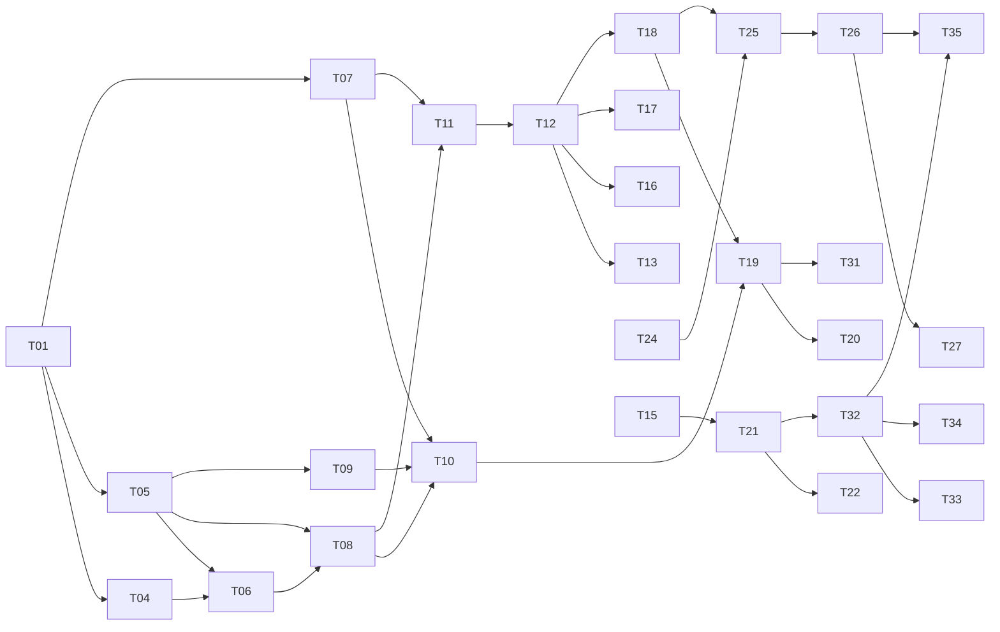

# Backlog de développement — Demandes de congé avec agent IA

> Ce backlog découpe le travail en tickets à partir du [PRD v1.4](PRD.md) et de l'[Architecture Brief](ARCHITECTURE.md).
>
> Version 1.0 du 01/11/2026. Les tickets sont des **tranches verticales** : chacun livre un comportement testable. Ils sont regroupés en epics et ordonnés par lot.

## Conventions

| Taille | Effort indicatif (avec assistance IA) |
|---|---|
| **S** | ≤ 1 h |
| **M** | 1,5 à 2 h |
| **L** | 3 à 4 h |

**Lots** :
- **J1**, **J2**, **J3** : jours 1, 2 et 3.
- **V2** : tickets coupés de la V1 (voir « Capacité »).

**Références** : R (règle), A (cas limite de l'agent) et C (conformité) renvoient au PRD ; AD renvoie à une décision d'architecture.

**Définition de « terminé »** pour chaque ticket :
- le code est en anglais (AD22) ;
- les tests unitaires passent avec `dotnet test`, sans clé d'API ni réseau ;
- les tests d'architecture restent verts ;
- aucun identifiant, texte libre ou identité dans les journaux (C3) ;
- l'OpenAPI est à jour pour toute route ajoutée.

---

## Capacité et ligne de coupe

Il y a **2 à 3 jours de disponibles**, soit environ **20 à 24 h de travail effectif**. Le périmètre complet de l'Architecture Brief représente environ **45 à 55 h**. Il ne tient donc pas tel quel.

| Ensemble | Estimation | Contenu |
|---|---|---|
| **J1 + J2 + J3** | ≈ 34 h | Domaine, event store, API, Assistant, BFF, Payroll in-process, Angular sur un écran, livrables |
| **V2** | ≈ 6 h | Redis, RabbitMQ et outbox, purge par événements, tests Testcontainers (coupes K1 à K3) |

**Ordre de priorité.** Les lots suivent la grille d'évaluation de TF1 :
1. modélisation du domaine (25 %) ;
2. agent IA (25 %) ;
3. tests (20 %) ;
4. API et erreurs (15 %) ;
5. usage de l'IA (15 %).

À chaque fin de journée, l'existant est cohérent et démontrable.

**Coupes validées** (« on coupe pas de soucis », AD56) :

| # | Proposition | Gain | Décision touchée |
|---|---|---|---|
| K1 | Sessions de la BFF en mémoire plutôt que dans Redis | ≈ 1 h | AD20 |
| K2 | Pas de RabbitMQ en V1 : purge des conversations par la route `closure` (appelée par le front) et le job à 30 jours. Payroll devient un BC sans API, hébergé dans l'hôte HrAdministration et alimenté in-process (AD57). | ≈ 3 h | AD8, AD20 |
| K3 | Pas de tests Testcontainers : les invariants de l'event store sont testés avec un store en mémoire | ≈ 2 h | §9 de l'architecture |
| K4 | Angular minimal : un seul écran (compteurs, formulaire, liste, panneau agent), avec simulation sur bouton plutôt qu'en direct | ≈ 3 h | §7 de l'architecture |

Même avec ces coupes, J2 reste chargé. Si la marge manque, on reporte en priorité T31 (Payroll), puis T22 (portée `agent` côté BFF). Ce sont des raffinements : le cœur du sujet n'en dépend pas.

---

## Plan par jour

| Jour | Objectif démontrable en fin de journée | Tickets |
|---|---|---|
| **J1** | Domaine complet et testé (R1 à R11), solution structurée, tests d'architecture verts | T01 à T10 |
| **J2** | API HrAdministration persistée (event store, seed) et agent qui prépare un brouillon via des tools testés | T11 à T20, T24 à T27, T36 |
| **J3** | Parcours complet dans le navigateur (BFF, Angular), Payroll in-process et livrables du test | T21, T22, T28, T31 à T35, T37, T38 |

---

## E0 — Socle

| ID | Ticket | Taille | Lot | Dépend de | Réf. | Critères d'acceptation |
|---|---|---|---|---|---|---|
| T01 | Structure de la solution | S | J1 | — | AD2, AD10 | Projets conformes à §8 de l'architecture. `SharedKernel` réduit à `AggregateRoot`, `Entity`, `IDomainEvent`, `Result`. `Directory.Build.props` (nullable, warnings en erreur). `dotnet build` vert. |
| T02 | Aspire AppHost et ServiceDefaults | M | J1 | T01 | AD20, AD56 | `dotnet run --project src/AppHost` démarre PostgreSQL (une base par hôte), les hôtes HrAdministration et Assistant, et la BFF, tous vides. Ni RabbitMQ ni Redis. OpenTelemetry branché. |
| T03 | Tests d'architecture | M | J1 | T01 | AD5, AD28 | Règles de §9 de l'architecture : dépendances Domain, Application et Infrastructure ; `HrCalendar` isolé ; Assistant et Payroll limités à `HrAdministration.Contracts` ; Payroll sans contrôleur ; SharedKernel minimal ; pas de `DELETE` sur les demandes. |

## E1 — Domaine HrAdministration

| ID | Ticket | Taille | Lot | Dépend de | Réf. | Critères d'acceptation |
|---|---|---|---|---|---|---|
| T04 | Calendrier férié et qualification des jours | M | J1 | T01 | R2, R11, D45 | `PublicHolidayCalendar` : `General` (11 jours) et `AlsaceMoselle` (13 jours, Vendredi saint et 26 décembre). Pâques en table, de 2025 à 2030. `CalendarResolver` (57, 67, 68). `WorkSchedule` (`FullTime5Days`, `PartTime80`). `DayQualifier`. Tests sur 2026 et 2027. |
| T05 | Value objects de la demande | S | J1 | T01 | R1, R6 | `LeavePeriod`, `PeriodBound`, `HalfDay` (Après-midi→Matin invalide le même jour). `LeaveType` avec `IsSensitive`. `Comment` limité à 200 caractères et refusé pour `SickLeave`. |
| T06 | Politique de décompte | M | J1 | T04, T05 | R2, D39, D40, A8 | Décompte en jours ouvrés par pas de 0,5. Décompte légal des CP à temps partiel : les **5 lignes du tableau 4.1 du PRD** sont rejouées, dont mardi après-midi = 0,5 j. Maladie et Sans solde en jours travaillés. Durée nulle invalide. |
| T07 | Agrégat `LeaveBalance` (event-sourcé) | M | J1 | T01 | R3, R9, AD30, AD63 | Compteurs `PaidLeave` et `Rtt`. Événements `EntitlementGranted` (avec `CurrentYearOnly`), `DaysDeducted`, `DaysCredited`. `Acquired`, `Taken` et `Planned` selon `IClock`, `Available`. Solde insuffisant refusé. Période à cheval sur deux années civiles ou hors de l'année du compteur refusée (D59, AD64). Un compteur `CurrentYearOnly` ne vaut que pour l'année civile en cours. Une seule déduction par demande. Tests *given / when / then*. |
| T08 | Agrégat `LeaveRequest` (event-sourcé) | L | J1 | T05, T06 | R1, R5, R6, R7, C17 | Brouillon : création et mise à jour. Soumission. Annulation d'un brouillon, ou d'une demande soumise avant son début. `BackdatingPolicy` : antériorité seulement pour la Maladie, avertissement `declaration.late` au-delà de 48 h. `Origin`, `Flags` et `Warnings`. Aucune suppression. |
| T09 | Politique de chevauchement | S | J1 | T05 | R4 | Chevauchement refusé à la demi-journée près (matin + après-midi du même jour autorisés). Brouillons, demandes annulées et remplacées ignorés. Exception R10 déléguée à T10. |
| T10 | Écrasement par un arrêt maladie | L | J1 | T07, T08, T09 | R10, A7 | Une demande CP, RTT ou Sans solde chevauchée est **raccourcie**, **scindée** ou **remplacée**. Les demi-journées retirées sont recréditées, même si le congé a commencé. `Taken` et `Planned` suivent le nouveau premier jour d'une demande raccourcie par le début et de la seconde partie d'une demande scindée (à faire évoluer sur `DaysCredited` ou `DaysDeducted`, qui ne connaissent que le premier jour d'origine). Deux arrêts maladie restent incompatibles. Aperçu de l'écrasement disponible avant soumission. |

## E2 — Persistance (event sourcing)

| ID | Ticket | Taille | Lot | Dépend de | Réf. | Critères d'acceptation |
|---|---|---|---|---|---|---|
| T11 | Event store maison sur EF Core | M | J2 | T02, T07, T08 | AD48, AD49, C17 | Table `events` avec contrainte unique `(stream_id, version)`. Ajout dans plusieurs flux en une seule transaction. Conflit → 409. Métadonnées : acteur, origine, corrélation. Aucun `UPDATE` ni `DELETE`. Migration EF. |
| T12 | Projections inline et fiche RH | M | J2 | T11 | AD55 | `leave_requests_view` et `balances_view` mises à jour dans la transaction. Table `employee_profiles` (modèle de lecture). Reconstruction des projections par rejeu. |
| T13 | Seed idempotent | M | J2 | T12 | R8, AD51, AD53 | Cinq employés de démo (PRD R8). `EntitlementGranted` pour 2026 et 2027, avec `CurrentYearOnly` pour les JRTT du forfait jours. Demandes passées qui entament les soldes. Seed passant par le même chemin que l'application. Relancer le seed ne crée pas de doublon. |
| T14 | Tests de l'event store (store en mémoire) | S | J2 | T11, T12 | §9, AD56 | Conflit de version (409), deux soumissions simultanées d'un même employé (une seule aboutit, AD60), égalité entre rejeu et projections inline, seed idempotent, sans Docker. *Testcontainers en V2 (K3).* |

## E3 — API HrAdministration

| ID | Ticket | Taille | Lot | Dépend de | Réf. | Critères d'acceptation |
|---|---|---|---|---|---|---|
| T15 | Hôte API et transverses | M | J2 | T02 | AD3, AD29, AD37, C5 | Versionnement `/api/v1`. OpenAPI avec Scalar. ProblemDetails avec les codes de §6 de l'architecture. `ICurrentEmployee` alimenté par le jeton interne. Portée `agent` en **liste blanche** : `POST` et `PUT` d'un brouillon `Agent` uniquement, sinon 403. 404 sur la ressource d'un autre employé. |
| T16 | Fiche et compteurs | S | J2 | T12, T15 | AD44, R3, R9 | `GET hr-record` renvoie l'identité seule. `GET balances` renvoie acquis, pris, planifiés et disponible. `POST balances/simulations` renvoie les jours décomptés, le solde après et la faisabilité. |
| T17 | Routes calendrier | S | J2 | T04, T12, T15 | R2, R4, R11, C15 | `GET calendar/working-days`, `calendar/leaves` et `calendar/sick-leaves`. Pour la Maladie, seules les périodes sont renvoyées. |
| T18 | Brouillons et liste des demandes | M | J2 | T08 à T12, T15 | R1 à R6, A3 | `POST leave-requests` (simule et crée) et `PUT leave-requests/{id}` (brouillon seulement, sinon `request.invalid_status`). La réponse contient durée, solde après, flags, écrasements et warnings. `GET leave-requests` liste tous les statuts. |
| T19 | Soumission et annulation | M | J2 | T10, T11, T18 | R3, R4, R7, R10, AD45, AD60 | `submission` : contrôle complet, déduction interne et R10 dans **une seule transaction**, avec écriture dans `agenda-{employee}` à la version lue avant le contrôle de R4 et R10 (conflit → 409). `cancellation` : brouillon, ou demande soumise non commencée, avec recrédit. Aucune route de déduction ni de `DELETE`. |
| T20 | Tests d'API | M | J2 | T16 à T19 | AD5, C11 | `WebApplicationFactory` sur les 11 routes. ProblemDetails. Warnings renvoyés en 200 ou 201. 404 sur la ressource d'un autre employé. 403 sur toute route hors liste blanche avec la portée `agent`. Soumission rejouée = une seule déduction. |
| T36 | Journaux conformes | S | J2 | T15 | C3, C15, AD29 | Journalisation en liste blanche. Enrichisseur `SickLeave` → `sensitive`. Test avec un logger de test : aucun commentaire, aucune identité, aucun type Maladie en clair. |

## E4 — BFF et session

| ID | Ticket | Taille | Lot | Dépend de | Réf. | Critères d'acceptation |
|---|---|---|---|---|---|---|
| T21 | Gateway.Bff | M | J3 | T15 | AD4, AD19 | `POST /api/v1/session` (employé de démo). Cookie opaque `HttpOnly`, `Secure`, `SameSite=Strict`, anti-CSRF. Émission du jeton interne (portée `employee`, audience par service). Routes YARP `/me/...`. Service du front Angular. Aucun jeton ni identifiant visible côté navigateur. |
| T22 | Jeton délégué de l'agent | S | J3 | T21 | AD37, C11 | Échange du jeton `aud=assistant` contre un jeton de portée `agent` destiné à HrAdministration. |
| T23 | Sessions dans Redis | S | V2 | T21 | AD20 | Store de session distribué Redis. *Coupé (K1, AD56).* |

## E5 — Assistant (agent IA)

| ID | Ticket | Taille | Lot | Dépend de | Réf. | Critères d'acceptation |
|---|---|---|---|---|---|---|
| T24 | Agrégat `Conversation` et persistance | M | J2 | T02 | C6, C13, C14 | 10 tours au plus (le 11ᵉ donne 429). Brouillon lié stocké côté serveur. Statut et expiration à 30 jours. Sorties sous forme de codes. Table `messages` purgeable. |
| T25 | 4 tools et client HrAdministration | M | J2 | T18, T24 | AD33, A2, A3, A5 | `request_paid_leave`, `request_rtt`, `request_unpaid_leave`, `declare_sick_leave` (sans `comment`). `POST` au premier tour, `PUT` ensuite. Les `assumptions[]` deviennent des incertitudes. `IHrAdministrationClient` n'expose **que** `POST` et `PUT`. |
| T26 | Orchestration LLM et garde-fous | L | J2 | T25 | AD9, A1, A4, A6, A9, C2, C4, C9 | Adaptateur Groq (`IChatClient` compatible OpenAI, clé dans les user-secrets). Prompt système avec la date du jour, sans identité ni identifiant. Intentions `off_topic` et `unsupported_leave_type` traduites en **messages fixes** (texte de A9). Mention « Réponse générée par une IA » ajoutée par le back-end. |
| T27 | Tests de l'agent | M | J2 | T26 | AD5, C11 | `IChatClient` scripté et client simulé. Workflow des 4 tools. Aucun identifiant ni nom dans les messages envoyés au LLM. Pas de paramètre `comment` sur la Maladie. 11ᵉ tour refusé. Messages fixes A1 et A9. Aucun contenu dans les journaux. |
| T28 | Clôture et purge | S | J3 | T24 | C6, C8, AD56 | `POST conversations/{id}/closure` purge le contenu et garde la trace. Job de purge à 30 jours (filet de sécurité). |

## E6 — Payroll et messagerie

| ID | Ticket | Taille | Lot | Dépend de | Réf. | Critères d'acceptation |
|---|---|---|---|---|---|---|
| T31 | BC Payroll in-process (squelette) | S | J3 | T19 | AD8, AD57 | Projets `Payroll.{Domain,Application,Infrastructure}` chargés par l'hôte HrAdministration, **sans API**. Les événements d'intégration de `HrAdministration.Contracts` sont distribués in-process, dans la transaction de soumission. Seuls `UnpaidLeave` et `SickLeave` sont retenus. Schéma `payroll` avec son propre `DbContext`. Idempotence par événement. |
| T29 | RabbitMQ, MassTransit et outbox | M | V2 | T11 | AD20 | Événements d'intégration publiés via l'outbox. *Coupé (K2, AD56).* |
| T30 | Purge des conversations par événement | S | V2 | T28, T29 | C6 | Consommation de `LeaveRequestSubmitted` et `LeaveRequestCancelled`. *Coupé (K2, AD56).* |

## E7 — Front-end Angular

| ID | Ticket | Taille | Lot | Dépend de | Réf. | Critères d'acceptation |
|---|---|---|---|---|---|---|
| T32 | Coque, session et en-tête | M | J3 | T21 | 6.2 | Choix de l'employé de démo. En-tête avec l'identité. Compteurs (acquis, pris, planifiés, disponible). Appels uniquement vers la BFF. |
| T33 | Formulaire avec calendrier | M | J3 | T32, T17, T18 | 6.3, R2, R6, R10, R11, AD56 | Sur l'écran unique (K4) : jours fériés et jours non travaillés signalés, périodes posées visibles, demi-journées. Pas de commentaire pour la Maladie. Simulation sur bouton « Simuler ». Avertissements. Confirmation avant écrasement. Soumission. |
| T34 | Mes demandes | S | J3 | T32 | 6.3, R7 | Liste de tous les statuts. Reprendre un brouillon. Annuler. |
| T35 | Panneau de l'agent | M | J3 | T26, T28, T32 | 6.4, C6, C9, C10 | Conversation. Badges « Réponse générée par une IA » et « Proposé par l'IA, à vérifier ». Champs hypothétiques mis en évidence. Ouverture du brouillon dans le formulaire. Fin de conversation au 10ᵉ tour. Après la soumission ou l'annulation d'un brouillon de l'agent, le front appelle `closure`. |

## E8 — Livrables du test

| ID | Ticket | Taille | Lot | Dépend de | Réf. | Critères d'acceptation |
|---|---|---|---|---|---|---|
| T37 | README | S | J3 | — | Énoncé | Prérequis (.NET 10, Docker, Node). `dotnet run --project src/AppHost`. Configuration de la clé Groq (user-secrets). `dotnet test` sans clé. Liens vers PRD, ARCHITECTURE et BACKLOG. |
| T38 | `AI_JOURNAL.md` et `ai-history/` | S | J3 | — | Énoncé | Journal d'une page au plus : outils utilisés, un exemple de gain de temps, un exemple de proposition rejetée ou retravaillée (par exemple AD24, AD27, AD52, D40). Export brut des sessions dans `ai-history/`, secrets masqués uniquement. |

---

## Dépendances principales

